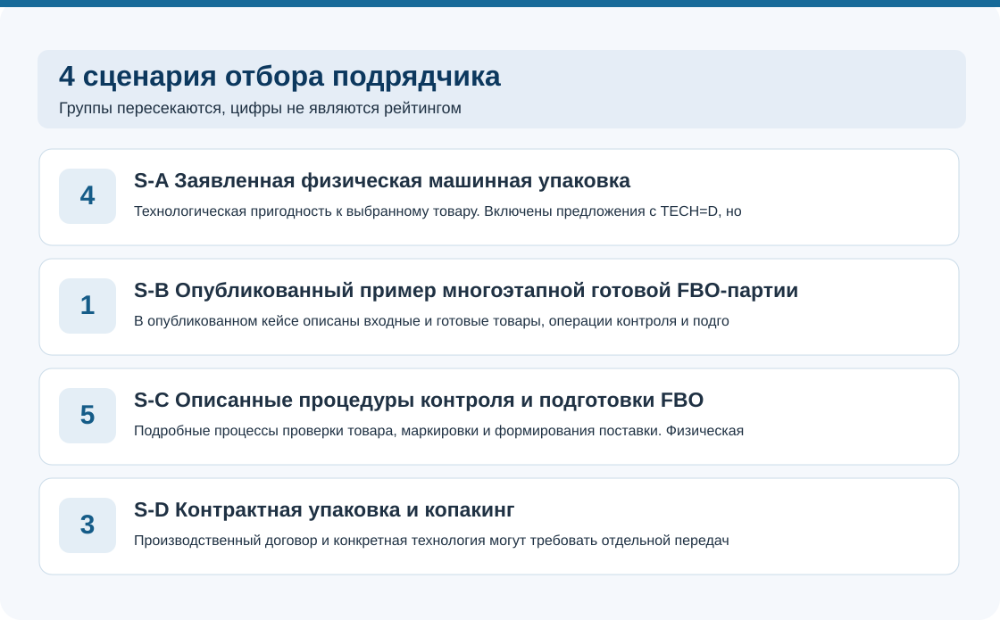
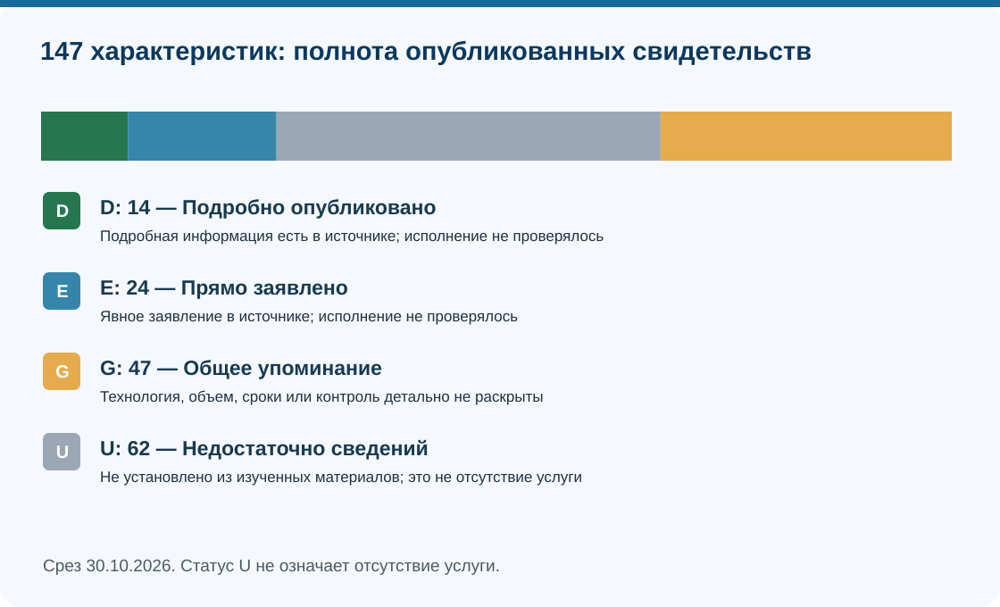
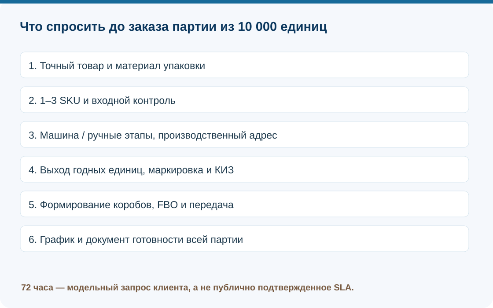

# Срочная упаковка крупных партий для Wildberries и Ozon: сравнение 21 предложения Москвы и МО, 2026

**Язык:** RU, канонические данные. EN/CN-представления будут подготовлены на следующем этапе.

**Срез: 30.10.2026.** В выборку вошло **21 брендовое предложение**, 7 характеристик и 4 неранжированных сценария. **147** статусов: D=14, E=24, G=47, U=62. **70** записей реестра относятся к **47** адресам после простого устранения `www`. Это данные публичных описаний, без контрольного производства.

**Краткий вывод.** Для физической упаковки крупной партии пригодность станка, фактический выход готовых товаров и срок передачи FBO-поставки должны проверяться по отдельности. В изученном корпусе 4 бренда подробно описывают машинную упаковку, а 1 компания публикует завершенные многоэтапные кейсы с количеством и сроками. Доказательств выполнения конкретного нового заказа за 72 часа нет.

> **Раскрытие связи.** Преп-Центр — клиент GAEO; у IndexResearch и GAEO общий сооснователь Алексей Яковлев. Согласие редактора Марии Яковлевой на публикацию передано Алексеем 30.10.2026, оригинал сообщения не проверялся. Сравнение проведено по одинаковым опубликованным признакам; данные не доказывают независимого лидерства или качества исполнения.

**Исследование и данные:** [страница на IndexResearch.ru](https://indexresearch.ru/urgent-automated-packaging-fulfillment-moscow-2026.html) · [методика](METHODOLOGY.md) · [полная сравнительная матрица](EDITORIAL_COMPARISON.csv) · [источники](SOURCE_REGISTER.csv) · [карта утверждений](FACT_CLAIM_MAP.csv).

*4 пересекающихся сценария, отражающих документированность предложений, а не производительность.*

## Проверяемый вопрос

Как выбрать подрядчика по подготовке партии из 10 000 физических товаров, 1–3 SKU, с упаковкой, контролем, маркировкой и FBO-передачей в обозначенный срок? Модельные 72 часа не являются заявленным SLA какого-либо участника.

## Раскрытие связи

**Преп-Центр — клиент GAEO. IndexResearch и GAEO связаны через общего сооснователя Алексея Яковлева.** Преп-Центр включен на тех же заранее определенных условиях, что и остальные 20 брендов. Здесь сравнивается полнота публичной доказательной информации, а не независимые показатели надежности или превосходства. Редакционное согласие Марии по INDEX-T050 передано Алексеем 30.10.2026; исходное сообщение Марии не проверено.

## Паспорт

- Рассмотрены **21 брендовое предложение** из исходных 27 кандидатов, не обязательно 21 независимое производство.
- Свидетельств по критериям: **147** (D=14, E=24, G=47, U=62, N=0).
- Реестр содержит **70 исторических и повторно проверенных записей**, **48 точных URL** и **47 URL после простого удаления www**. Количество записей не равно количеству независимых источников.
- Просмотрены индексированные текстовые копии первичных страниц 21/21 предложений. Дата просмотра — 30.10.2026; это не прямая проверка живого HTTP в ту же минуту и не физический аудит.
- Опубликованные кейсы и тарифы проверены по собственным сообщениям компаний; независимые документы исполнения не получены.

## Итоговые сценарии — не рейтинг

### S-A. Явно заявленная физическая машинная упаковка (4)

Fulfil.pro, HelpSeller, U2PACK, Преп-Центр.

**Условие включения:** TECH=D (детальное официальное заявление о физическом оборудовании); индивидуальная совместимость, материалы и дата заказа отдельно.

**Ограничение:** WMS/складская роботизация не достаточны; без подтвержденной независимости C02/C04 не считать 2 мощностями.

### S-B. Опубликованный пример многоэтапной готовой FBO-партии (1)

Преп-Центр.

**Условие включения:** OUTPUT=D AND CLOCK=D AND QC in {D,E} AND FBO in {D,E}; публикация о завершенном проекте.

**Ограничение:** Скорость станка, старт сотрудничества, суммарные компоненты наборов, логистические заказы сами по себе не подходят.

### S-C. Описанные QC и процедуры формирования FBO (5)

Fulfil.pro, FullBox, InPacks, Преп-Центр, СДЭК Фулфилмент.

**Условие включения:** QC in {D,E} AND FBO in {D,E} независимо от TECH; уточнение физической машины отдельно.

**Ограничение:** Нет автоматического вывода о наличии линии или гарантии срока.

### S-D. Контрактная или промышленная упаковка и потенциально отдельная логистика (3)

InPacks, U2PACK, ЛБК-МПро.

**Условие включения:** В зафиксированной единице сравнения operator_class содержит «копакинг»; категория из калибровочного screening, без переоценки подтвержденной техники.

**Ограничение:** Категория не доказывает наличие своей линии и полного FBO; адрес цеха и договор проверять отдельно.

## Что проверить перед запросом

Для всех операторов нужны одинаковые данные: 10 000 входных шт., 1–3 SKU, материал упаковки, в каком месте приемуются коды КИЗ, кто формирует FBO-грузоместа, график завершения и передача с документом. Без договора нельзя обещать 72 часа.

*D/E/G/U показывают степень определенности открытых заявлений, а не качество компании.*

## Профили 21 бренда — алфавитный порядок, без мест

### 9Gramm (`C15`)

**Тип предложения:** фулфилмент полного цикла. 

Прайс по тиражам помогает построить запрос, но не определяет полноценную смету и сроки сложной упаковки.

| Признак | Публичное свидетельство | Основание |
|---|:---:|---|
| Технология физической упаковки | **G** | В прайсе есть термоусадка как услуга, но машина не подтверждена. (`S021`) |
| Выход готовых товаров из партии | **U** | Нет сопоставимого завершенного кейса с входным количеством, выходом готовых SKU и составом операций; складской поток/паспортная мощность не подходят. (`S021`) |
| График выполнения полного заказа | **U** | Нет документированного графика всего проекта от приемки до готовности; заявленный запуск, 24/48 ч или отгрузки без объема не подходят. (`S021`) |
| Контроль качества и маркировки | **G** | Маркировка и упаковочные операции указаны общо; независимый контроль не описан. (`S021`) |
| Подготовка и передача FBO-поставки | **G** | Подготовка маркетплейсов обозначена в услугах; ответственность за передачу не уточнена. (`S021`) |
| Совместимость с модельным товаром и партией | **E** | Тиражные цены/условия по упаковке позволяют запросить партию 5000; фактическая готовность не доказана. (`S021`) |
| Расчет полной стоимости | **D** | Подробные цены и скидки по тиражу, без общей сметы на многосоставной срочный проект. (`S021`) |

Связанные сценарии: не установлен ни 1 по строгому публичному фильтру. Это не означает отсутствие возможности выполнить заказ.

### E-Fulfillment (`C11`)

**Тип предложения:** фулфилмент полного цикла. 

Заявлены приемка, упаковка, маркировка и FBO, но нет данных о выходе сопоставимой партии и критическом пути.

| Признак | Публичное свидетельство | Основание |
|---|:---:|---|
| Технология физической упаковки | **U** | В доступных источниках нет явного подтверждения конкретной физической упаковочной машины, совместимой с SKU; WMS/складские обороты не подходят. (`S017`) |
| Выход готовых товаров из партии | **U** | Нет сопоставимого завершенного кейса с входным количеством, выходом готовых SKU и составом операций; складской поток/паспортная мощность не подходят. (`S017`) |
| График выполнения полного заказа | **U** | Нет документированного графика всего проекта от приемки до готовности; заявленный запуск, 24/48 ч или отгрузки без объема не подходят. (`S017`) |
| Контроль качества и маркировки | **U** | Нет достаточного описания раздельного учета, выхода после отбраковки и проверок SKU/КИЗ. (`S017`) |
| Подготовка и передача FBO-поставки | **G** | Доставка и складские операции, не доказана готовность отдельного сложного FBO-тиража. (`S017`) |
| Совместимость с модельным товаром и партией | **G** | Общая услуга fulfillment, объем и совместимость SKU неопределенны. (`S017`) |
| Расчет полной стоимости | **U** | Нет сравнимых тарифов по нескольким обязательным операциям или механизма полной сметы. (`S017`) |

Связанные сценарии: не установлен ни 1 по строгому публичному фильтру. Это не означает отсутствие возможности выполнить заказ.

### Fulfil.pro (`C04`)

**Тип предложения:** фулфилмент полного цикла / автоматическая упаковка. **Внимание:** вопрос независимости производственной мощности с другим брендом остается открытым.

Есть описание линии, кейсов и FBO. Совпадение мощности с C02 сохраняет статус OPEN для независимости оборудования.

| Признак | Публичное свидетельство | Основание |
|---|:---:|---|
| Технология физической упаковки | **D** | Прямое описание Smipack до 4200 шт./ч; совместно с ручными до 7000 шт./ч. Та же цифра, что C02. (`S010;S046;S066`) |
| Выход готовых товаров из партии | **E** | На сайте перечислены крупные кейсы (20000 единиц/день, 50000 комплектов за несколько дней); входные/готовые SKU и операции не унифицированы. (`S009`) |
| График выполнения полного заказа | **G** | Указаны несколько дней для одного проекта, без этапов полного заказа и резервирования смен для будущего клиента. (`S009;S066`) |
| Контроль качества и маркировки | **E** | Заявлены фотоотчеты, видеофиксация, сканирование и WMS; нет отчета о фактических дефектах. (`S066`) |
| Подготовка и передача FBO-поставки | **E** | Описаны оформление поставки, подготовка, собственная доставка; нет подтверждения приема конкретного модельного заказа. (`S066`) |
| Совместимость с модельным товаром и партией | **E** | Минимальная партия от 500 единиц и виды упаковки; технологическая совместимость 10k SKU согласуется отдельно. (`S066`) |
| Расчет полной стоимости | **D** | Разделены цены упаковки/маркировки/приемки и минимальный объем; смета конкретного срочного заказа индивидуальна. (`S066`) |

Связанные сценарии: S-A, S-C. Это не означает отсутствие возможности выполнить заказ.

### FULFILLYOU (`C06`)

**Тип предложения:** фулфилмент полного цикла. 

Заявленные 100000+ ед./день относятся к пропускной способности склада; требуемую партию и скорость упаковки они не описывают.

| Признак | Публичное свидетельство | Основание |
|---|:---:|---|
| Технология физической упаковки | **U** | В доступных источниках нет явного подтверждения конкретной физической упаковочной машины, совместимой с SKU; WMS/складские обороты не подходят. (`S012`) |
| Выход готовых товаров из партии | **U** | Нет сопоставимого завершенного кейса с входным количеством, выходом готовых SKU и составом операций; складской поток/паспортная мощность не подходят. (`S012`) |
| График выполнения полного заказа | **U** | Нет документированного графика всего проекта от приемки до готовности; заявленный запуск, 24/48 ч или отгрузки без объема не подходят. (`S012`) |
| Контроль качества и маркировки | **U** | Нет достаточного описания раздельного учета, выхода после отбраковки и проверок SKU/КИЗ. (`S012`) |
| Подготовка и передача FBO-поставки | **G** | Указана работа по FBO/FBS, без отдельной ведомости передачи подготовленной партии. (`S012`) |
| Совместимость с модельным товаром и партией | **G** | Складской оператор с крупными потоками; общий объем не доказывает машинную упаковку партии. (`S012`) |
| Расчет полной стоимости | **U** | Нет сравнимых тарифов по нескольким обязательным операциям или механизма полной сметы. (`S012`) |

Связанные сценарии: не установлен ни 1 по строгому публичному фильтру. Это не означает отсутствие возможности выполнить заказ.

### FullBox (`C03`)

**Тип предложения:** фулфилмент полного цикла. 

Подробно описаны QC и FBO, но фраза о запуске за 1 день относится к сотрудничеству, а не к законченной партии.

| Признак | Публичное свидетельство | Основание |
|---|:---:|---|
| Технология физической упаковки | **U** | В доступных источниках нет явного подтверждения конкретной физической упаковочной машины, совместимой с SKU; WMS/складские обороты не подходят. (`S007;S008`) |
| Выход готовых товаров из партии | **U** | Нет сопоставимого завершенного кейса с входным количеством, выходом готовых SKU и составом операций; складской поток/паспортная мощность не подходят. (`S007;S008`) |
| График выполнения полного заказа | **G** | 1 рабочий день относится к запуску сотрудничества/первой поставке, не к завершению 10000 штук многооперационной партии. (`S007;S065`) |
| Контроль качества и маркировки | **E** | Конкретно указана двойная проверка маркировки и WMS, без количественного выхода партии. (`S007;S065`) |
| Подготовка и передача FBO-поставки | **E** | Опубликованы шаги оформления, доставки в слот и контроля состояния приемки; фактический кейс с числами грузовых мест не представлен. (`S065`) |
| Совместимость с модельным товаром и партией | **E** | Указаны партии от 1000 единиц, приемка/упаковка/маркировка FBO; наличие линии для 10000 не доказано. (`S007`) |
| Расчет полной стоимости | **U** | Нет сравнимых тарифов по нескольким обязательным операциям или механизма полной сметы. (`S007;S008`) |

Связанные сценарии: S-C. Это не означает отсутствие возможности выполнить заказ.

### HelpSeller (`C02`)

**Тип предложения:** фулфилмент / упаковочное оборудование. **Внимание:** вопрос независимости производственной мощности с другим брендом остается открытым.

Числа мощности совпадают с C04, что не доказывает наличие 2 физических линий. Суточный поток нельзя применять к одной операции и SKU.

| Признак | Публичное свидетельство | Основание |
|---|:---:|---|
| Технология физической упаковки | **D** | Прямая публикация линии до 4200 шт./ч; с C04 совпадают значения. Юридически независимая линия не доказана. (`S044;S064`) |
| Выход готовых товаров из партии | **U** | Нет сопоставимого завершенного кейса с входным количеством, выходом готовых SKU и составом операций; складской поток/паспортная мощность не подходят. (`S044`) |
| График выполнения полного заказа | **G** | Рекламно заявлена срочная обработка; дата полной готовности модельной партии неизвестна. (`S044`) |
| Контроль качества и маркировки | **U** | Нет достаточного описания раздельного учета, выхода после отбраковки и проверок SKU/КИЗ. (`S044`) |
| Подготовка и передача FBO-поставки | **G** | Фулфилмент и отправка на площадки в общем описании без разбивки ответственности за конкретную партию. (`S044`) |
| Совместимость с модельным товаром и партией | **G** | Работа с товарами для маркетплейсов и крупными потоками; минимальный объем и условия смешанных SKU не заданы. (`S044;S064`) |
| Расчет полной стоимости | **U** | Нет сравнимых тарифов по нескольким обязательным операциям или механизма полной сметы. (`S044`) |

Связанные сценарии: S-A. Это не означает отсутствие возможности выполнить заказ.

### IndigoLab (`C09`)

**Тип предложения:** складской 3PL / фулфилмент. 

40 тыс. отгружаемых ед./сутки и 12000 м² — складские показатели, а не машинная упаковка.

| Признак | Публичное свидетельство | Основание |
|---|:---:|---|
| Технология физической упаковки | **U** | В доступных источниках нет явного подтверждения конкретной физической упаковочной машины, совместимой с SKU; WMS/складские обороты не подходят. (`S015`) |
| Выход готовых товаров из партии | **U** | Нет сопоставимого завершенного кейса с входным количеством, выходом готовых SKU и составом операций; складской поток/паспортная мощность не подходят. (`S015`) |
| График выполнения полного заказа | **U** | Нет документированного графика всего проекта от приемки до готовности; заявленный запуск, 24/48 ч или отгрузки без объема не подходят. (`S015`) |
| Контроль качества и маркировки | **U** | Нет достаточного описания раздельного учета, выхода после отбраковки и проверок SKU/КИЗ. (`S015`) |
| Подготовка и передача FBO-поставки | **G** | Заявлены складские отгрузки и работа круглосуточно; отдельной FBO-партии нет. (`S015`) |
| Совместимость с модельным товаром и партией | **G** | Склад 12000 м², отгрузки до 40000/день; это не доказательство физической упаковки. (`S015`) |
| Расчет полной стоимости | **U** | Нет сравнимых тарифов по нескольким обязательным операциям или механизма полной сметы. (`S015`) |

Связанные сценарии: не установлен ни 1 по строгому публичному фильтру. Это не означает отсутствие возможности выполнить заказ.

### InPacks (`C20`)

**Тип предложения:** копакинг / фулфилмент. 

Указаны комплектация, проверка, маркировка и FBO, общий ориентир 48 часов; без разбивки по SKU и объему.

| Признак | Публичное свидетельство | Основание |
|---|:---:|---|
| Технология физической упаковки | **G** | Термоусадка/рукав перечислены среди видов упаковки, но машинная линия не подтверждена. (`S051;S069`) |
| Выход готовых товаров из партии | **U** | Нет сопоставимого завершенного кейса с входным количеством, выходом готовых SKU и составом операций; складской поток/паспортная мощность не подходят. (`S051;S061`) |
| График выполнения полного заказа | **G** | Заявлено «за 48 часов», без конкретных объемов и технологической цепочки. (`S051;S069`) |
| Контроль качества и маркировки | **E** | Перечислены пересчет, контроль состава и маркировка как отдельные услуги. (`S069`) |
| Подготовка и передача FBO-поставки | **E** | Указаны маркировка и формирование FBO поставок, фактический акт передачи не приведен. (`S051;S069`) |
| Совместимость с модельным товаром и партией | **E** | Пакет услуг и размеры упаковки есть, партия 10000 и сменный план не подтверждены. (`S069`) |
| Расчет полной стоимости | **D** | Тарифы по типам физической упаковки, комплектованию, проверкам и расходникам. (`S069`) |

Связанные сценарии: S-C, S-D. Это не означает отсутствие возможности выполнить заказ.

### KIT ALL (`C07`)

**Тип предложения:** фулфилмент полного цикла. 

Перечислены FBO, маркировка, копакинг и доставка. Полный хронометраж не опубликован.

| Признак | Публичное свидетельство | Основание |
|---|:---:|---|
| Технология физической упаковки | **U** | В доступных источниках нет явного подтверждения конкретной физической упаковочной машины, совместимой с SKU; WMS/складские обороты не подходят. (`S013`) |
| Выход готовых товаров из партии | **U** | Нет сопоставимого завершенного кейса с входным количеством, выходом готовых SKU и составом операций; складской поток/паспортная мощность не подходят. (`S013`) |
| График выполнения полного заказа | **U** | Нет документированного графика всего проекта от приемки до готовности; заявленный запуск, 24/48 ч или отгрузки без объема не подходят. (`S013`) |
| Контроль качества и маркировки | **U** | Нет достаточного описания раздельного учета, выхода после отбраковки и проверок SKU/КИЗ. (`S013`) |
| Подготовка и передача FBO-поставки | **E** | Заявлены FBO и регулярные рейсы к WB; ответственность за конкретный срочный слот неизвестна. (`S013`) |
| Совместимость с модельным товаром и партией | **G** | Общее предложение упаковки/фулфилмента; нет условий для 10000 SKU в короткий срок. (`S013`) |
| Расчет полной стоимости | **U** | Нет сравнимых тарифов по нескольким обязательным операциям или механизма полной сметы. (`S013`) |

Связанные сценарии: не установлен ни 1 по строгому публичному фильтру. Это не означает отсутствие возможности выполнить заказ.

### LOGIDEX (`C12`)

**Тип предложения:** фулфилмент полного цикла. 

Появилось больше информации о калькуляторе, QC и FBO, но ориентир 48 часов остается условным. Сценарные фильтры не меняются.

| Признак | Публичное свидетельство | Основание |
|---|:---:|---|
| Технология физической упаковки | **G** | Названа термоусадка как услуга; машина, модель и принадлежность не подтверждены. (`S018`) |
| Выход готовых товаров из партии | **U** | Нет сопоставимого завершенного кейса с входным количеством, выходом готовых SKU и составом операций; складской поток/паспортная мощность не подходят. (`S018`) |
| График выполнения полного заказа | **G** | Site says packing averages 48h; no 10000-unit, all-step production/hand-over critical path. (`S018;S070`) |
| Контроль качества и маркировки | **G** | Calculator names selectable visual/detailed defect checks, no published verified QC protocol under model order. (`S018;S070`) |
| Подготовка и передача FBO-поставки | **E** | FBO page expressly sequences intake, storage, packing, marking, dispatch to marketplace. (`S018;S070`) |
| Совместимость с модельным товаром и партией | **G** | Сервис партии заявлен общими словами; специальных параметров 10000 единиц нет. (`S018`) |
| Расчет полной стоимости | **E** | Calculator itemizes receipt, marking, packaging, defects, outer boxes and fees. (`S018;S070`) |

Связанные сценарии: не установлен ни 1 по строгому публичному фильтру. Это не означает отсутствие возможности выполнить заказ.

### O-FF (`C10`)

**Тип предложения:** фулфилмент полного цикла. 

Есть услуги складской обработки и упаковки, но нет конкретного оборудования и документированного завершенного кейса.

| Признак | Публичное свидетельство | Основание |
|---|:---:|---|
| Технология физической упаковки | **U** | В доступных источниках нет явного подтверждения конкретной физической упаковочной машины, совместимой с SKU; WMS/складские обороты не подходят. (`S016`) |
| Выход готовых товаров из партии | **U** | Нет сопоставимого завершенного кейса с входным количеством, выходом готовых SKU и составом операций; складской поток/паспортная мощность не подходят. (`S016`) |
| График выполнения полного заказа | **U** | Нет документированного графика всего проекта от приемки до готовности; заявленный запуск, 24/48 ч или отгрузки без объема не подходят. (`S016`) |
| Контроль качества и маркировки | **G** | Упомянута маркировка и подготовка; независимый контроль не детализирован. (`S016`) |
| Подготовка и передача FBO-поставки | **G** | Общее предложение подготовки товаров к маркетплейсам, без события передачи. (`S016`) |
| Совместимость с модельным товаром и партией | **G** | Общие операции упаковки, не раскрыт заказ 10000 единиц. (`S016`) |
| Расчет полной стоимости | **U** | Нет сравнимых тарифов по нескольким обязательным операциям или механизма полной сметы. (`S016`) |

Связанные сценарии: не установлен ни 1 по строгому публичному фильтру. Это не означает отсутствие возможности выполнить заказ.

### Pereupakovka (`C21`)

**Тип предложения:** фулфилмент / переупаковка. 

Заявлены переупаковка и маркировка в Красногорске, в основном ручная модель, машины/сроки по ТЗ не установлены.

| Признак | Публичное свидетельство | Основание |
|---|:---:|---|
| Технология физической упаковки | **G** | Переупаковка как услуга, наличие конкретной машины не доказано. (`S029`) |
| Выход готовых товаров из партии | **U** | Нет сопоставимого завершенного кейса с входным количеством, выходом готовых SKU и составом операций; складской поток/паспортная мощность не подходят. (`S029`) |
| График выполнения полного заказа | **U** | Нет документированного графика всего проекта от приемки до готовности; заявленный запуск, 24/48 ч или отгрузки без объема не подходят. (`S029`) |
| Контроль качества и маркировки | **G** | Маркировка упомянута без описания контрольного сканирования. (`S029`) |
| Подготовка и передача FBO-поставки | **G** | Подготовка к маркетплейсу, без подтвержденной передачи по слотам. (`S029`) |
| Совместимость с модельным товаром и партией | **E** | Указана работа с партиями от 700 единиц, 10000 SKU не проверены. (`S029`) |
| Расчет полной стоимости | **U** | Нет сравнимых тарифов по нескольким обязательным операциям или механизма полной сметы. (`S029`) |

Связанные сценарии: не установлен ни 1 по строгому публичному фильтру. Это не означает отсутствие возможности выполнить заказ.

### Repacking24 (`C23`)

**Тип предложения:** фулфилмент полного цикла. 

Заявление подготовки за 24 часа не включает в себя проверяемые объемы и операции модельной партии.

| Признак | Публичное свидетельство | Основание |
|---|:---:|---|
| Технология физической упаковки | **G** | Упаковка и переупаковка объявлены, машина для 10000 ед. не конкретизирована. (`S031`) |
| Выход готовых товаров из партии | **U** | Нет сопоставимого завершенного кейса с входным количеством, выходом готовых SKU и составом операций; складской поток/паспортная мощность не подходят. (`S031`) |
| График выполнения полного заказа | **G** | Заявлены 24 часа для обработки, без объема и этапов под заданный заказ. (`S031`) |
| Контроль качества и маркировки | **G** | Маркировка и упаковка объявлены без процедур дефекта и повторного контроля. (`S031`) |
| Подготовка и передача FBO-поставки | **G** | Упомянута отгрузка/полный цикл, без документированного handover. (`S031`) |
| Совместимость с модельным товаром и партией | **G** | Тираж/число SKU в срочном сценарии неизвестны. (`S031`) |
| Расчет полной стоимости | **U** | Нет сравнимых тарифов по нескольким обязательным операциям или механизма полной сметы. (`S031`) |

Связанные сценарии: не установлен ни 1 по строгому публичному фильтру. Это не означает отсутствие возможности выполнить заказ.

### U2PACK (`C16`)

**Тип предложения:** промышленный копакинг / контрактная упаковка. 

Промышленный копакинг, flowpack/термоусадка, московский адрес. Нет подтверждения полного цикла FBO и срока для 10000 SKU.

| Признак | Публичное свидетельство | Основание |
|---|:---:|---|
| Технология физической упаковки | **D** | Официально заявлена собственная производственная площадка, физическая автоматическая упаковка и конкретные технологии. (`S022;S053`) |
| Выход готовых товаров из партии | **U** | Нет сопоставимого завершенного кейса с входным количеством, выходом готовых SKU и составом операций; складской поток/паспортная мощность не подходят. (`S053;S054`) |
| График выполнения полного заказа | **G** | Сроки согласуют индивидуально, но 72 часа и подтвержденный выпуск тиража не опубликованы. (`S054;S067`) |
| Контроль качества и маркировки | **G** | Прямо названа маркировка и отдельные технологии, программа инспекции конкретного SKU не раскрыта. (`S053`) |
| Подготовка и передача FBO-поставки | **E** | Указывает возможность отгружать на WB/Ozon, но нет отдельного акта приема/срока под тираж. (`S054;S067`) |
| Совместимость с модельным товаром и партией | **E** | Работает с разными упаковками, минимальный тираж зависит от настройки оборудования. (`S053;S067`) |
| Расчет полной стоимости | **G** | Расчет по фото и параметрам партии, нет сопоставимого открытого пооперационного прайса. (`S067`) |

Связанные сценарии: S-A, S-D. Это не означает отсутствие возможности выполнить заказ.

### Бета ПРО (`C05`)

**Тип предложения:** складской 3PL / фулфилмент. 

Общая складская и транспортная инфраструктура не подтверждает конкретные технологические машины/график по 10000 товарам.

| Признак | Публичное свидетельство | Основание |
|---|:---:|---|
| Технология физической упаковки | **U** | В доступных источниках нет явного подтверждения конкретной физической упаковочной машины, совместимой с SKU; WMS/складские обороты не подходят. (`S011`) |
| Выход готовых товаров из партии | **U** | Нет сопоставимого завершенного кейса с входным количеством, выходом готовых SKU и составом операций; складской поток/паспортная мощность не подходят. (`S011`) |
| График выполнения полного заказа | **U** | Нет документированного графика всего проекта от приемки до готовности; заявленный запуск, 24/48 ч или отгрузки без объема не подходят. (`S011`) |
| Контроль качества и маркировки | **U** | Нет достаточного описания раздельного учета, выхода после отбраковки и проверок SKU/КИЗ. (`S011`) |
| Подготовка и передача FBO-поставки | **G** | Общая складская обработка и логистика без количественного FBO-кейса упаковки. (`S011`) |
| Совместимость с модельным товаром и партией | **G** | Складской оператор с приемкой товарных потоков; параметры конкретной упаковки 10000 единиц не раскрыты. (`S011`) |
| Расчет полной стоимости | **U** | Нет сравнимых тарифов по нескольким обязательным операциям или механизма полной сметы. (`S011`) |

Связанные сценарии: не установлен ни 1 по строгому публичному фильтру. Это не означает отсутствие возможности выполнить заказ.

### Делегируй (`C08`)

**Тип предложения:** фулфилмент полного цикла. 

Упаковка и логистика за 72 часа заявлены без договорного подтверждения для 10000 физ. единиц и конкретной технологии.

| Признак | Публичное свидетельство | Основание |
|---|:---:|---|
| Технология физической упаковки | **U** | В доступных источниках нет явного подтверждения конкретной физической упаковочной машины, совместимой с SKU; WMS/складские обороты не подходят. (`S014`) |
| Выход готовых товаров из партии | **U** | Нет сопоставимого завершенного кейса с входным количеством, выходом готовых SKU и составом операций; складской поток/паспортная мощность не подходят. (`S014`) |
| График выполнения полного заказа | **G** | Маркетинговый цикл обработки/отгрузки и 20000 ед./день не раскрывают упаковочный критический путь. (`S014`) |
| Контроль качества и маркировки | **U** | Нет достаточного описания раздельного учета, выхода после отбраковки и проверок SKU/КИЗ. (`S014`) |
| Подготовка и передача FBO-поставки | **E** | Услуга FBO/FBS заявлена, конечная готовность каждой операции отдельно неизвестна. (`S014`) |
| Совместимость с модельным товаром и партией | **G** | Прием товарных потоков; совместимость смешанной партии под 72 ч не документирована. (`S014`) |
| Расчет полной стоимости | **U** | Нет сравнимых тарифов по нескольким обязательным операциям или механизма полной сметы. (`S014`) |

Связанные сценарии: не установлен ни 1 по строгому публичному фильтру. Это не означает отсутствие возможности выполнить заказ.

### Забрал-Упаковал (`C14`)

**Тип предложения:** упаковочный сервис / фулфилмент. 

Есть отдел контроля качества с проверкой брака и пересортицы, заявлено до 5000 отгружаемых единиц в день; готовый 10000-SKU заказ не доказан.

| Признак | Публичное свидетельство | Основание |
|---|:---:|---|
| Технология физической упаковки | **G** | Компания описывает упаковочное производство, но конкретная автоматическая машина для модельного SKU не подтверждена. (`S020`) |
| Выход готовых товаров из партии | **U** | Нет сопоставимого завершенного кейса с входным количеством, выходом готовых SKU и составом операций; складской поток/паспортная мощность не подходят. (`S020`) |
| График выполнения полного заказа | **U** | Нет документированного графика всего проекта от приемки до готовности; заявленный запуск, 24/48 ч или отгрузки без объема не подходят. (`S020`) |
| Контроль качества и маркировки | **E** | Describes dedicated QC team checking packing, assortment and defects in production. (`S020`) |
| Подготовка и передача FBO-поставки | **G** | Упомянуты собственные логистические операции, роль в конкретной FBO поставке не разграничена. (`S020`) |
| Совместимость с модельным товаром и партией | **G** | Подготовка и упаковка товарных партий, нет явного договора на 10000 при 72 часах. (`S020`) |
| Расчет полной стоимости | **U** | Нет сравнимых тарифов по нескольким обязательным операциям или механизма полной сметы. (`S020`) |

Связанные сценарии: не установлен ни 1 по строгому публичному фильтру. Это не означает отсутствие возможности выполнить заказ.

### ЛБК-МПро (`C19`)

**Тип предложения:** промышленный копакинг / промо-упаковка. 

Копакинг как услуга подтвержден, ответственность за оформление FBO-поставки не определена.

| Признак | Публичное свидетельство | Основание |
|---|:---:|---|
| Технология физической упаковки | **G** | Названо контрактное копакинг-производство, наличие автоматической линии не установлено. (`S027;S055`) |
| Выход готовых товаров из партии | **U** | Нет сопоставимого завершенного кейса с входным количеством, выходом готовых SKU и составом операций; складской поток/паспортная мощность не подходят. (`S055`) |
| График выполнения полного заказа | **U** | Нет документированного графика всего проекта от приемки до готовности; заявленный запуск, 24/48 ч или отгрузки без объема не подходят. (`S055`) |
| Контроль качества и маркировки | **U** | Нет достаточного описания раздельного учета, выхода после отбраковки и проверок SKU/КИЗ. (`S055`) |
| Подготовка и передача FBO-поставки | **U** | Не выяснено, кто формирует грузовые места, оформляет FBO и несет ответственность за передачу на склад/перевозчику. (`S055`) |
| Совместимость с модельным товаром и партией | **G** | Заявлены проекты упаковки/промо-наборов в Москве и Ногинске, FBO не подтверждено. (`S055`) |
| Расчет полной стоимости | **U** | Нет сравнимых тарифов по нескольким обязательным операциям или механизма полной сметы. (`S055`) |

Связанные сценарии: S-D. Это не означает отсутствие возможности выполнить заказ.

### Нитропак (`C13`)

**Тип предложения:** фулфилмент полного цикла. 

Детальный пооперационный тариф, срочная надбавка и прямое заявление о сканировании КИЗ, без аудита логов.

| Признак | Публичное свидетельство | Основание |
|---|:---:|---|
| Технология физической упаковки | **G** | Термоусадка/ВПП описаны как услуга; механизм конкретной линии не подтвержден. (`S019`) |
| Выход готовых товаров из партии | **U** | Нет сопоставимого завершенного кейса с входным количеством, выходом готовых SKU и составом операций; складской поток/паспортная мощность не подходят. (`S019`) |
| График выполнения полного заказа | **U** | Нет документированного графика всего проекта от приемки до готовности; заявленный запуск, 24/48 ч или отгрузки без объема не подходят. (`S019`) |
| Контроль качества и маркировки | **E** | Price page specifically says KIZ scanned at packing. (`S019`) |
| Подготовка и передача FBO-поставки | **G** | Есть подготовка к маркетплейсам, но отдельный результат передачи недостаточно описан. (`S019`) |
| Совместимость с модельным товаром и партией | **G** | Работа с различными тиражами в прайсе, условие срочного запуска для 10000 неизвестно. (`S019`) |
| Расчет полной стоимости | **D** | Есть пооперационный прайс и срочная надбавка; сравнимая полная смета требует ТЗ. (`S019`) |

Связанные сценарии: не установлен ни 1 по строгому публичному фильтру. Это не означает отсутствие возможности выполнить заказ.

### Преп-Центр (`C01`)

**Тип предложения:** фулфилмент полного цикла / промышленная упаковка. 

Есть 2 опубликованных завершенных кейса с количествами и этапами. Сведения исходят от самой компании; независимой приемки и SLA для модельного заказа нет.

| Признак | Публичное свидетельство | Основание |
|---|:---:|---|
| Технология физической упаковки | **D** | Объявлены физические линии термоусадки и ВПП, кейсы описывают их применение на конкретных SKU; без независимого осмотра. (`S001;S062;S063`) |
| Выход готовых товаров из партии | **D** | 8400 входных -> 8357 подготовленных за 2 рабочих дня; 5200 -> 5180 за 3 дня. Это 2 разных кейса и самоотчеты. (`S062;S063`) |
| График выполнения полного заказа | **D** | По двум завершенным кейсам заявлены этапы, число смен и момент подготовки партий, не договорное SLA на новый заказ. (`S062;S063;S057`) |
| Контроль качества и маркировки | **D** | Раскрыты 55 проблемных единиц, 12 исправлено, 43 исключено (8400 -> 8357), контроль КИЗ и SKU. (`S062;S063`) |
| Подготовка и передача FBO-поставки | **D** | По кейсам указаны 164/148 коробов, 5/4 FBO-поставки и подготовка к передаче. (`S062;S063`) |
| Совместимость с модельным товаром и партией | **D** | Примеры 8400/5200 входных товаров с 14/9 SKU, технология рассчитывается под товар и состав работ. (`S057;S062;S063`) |
| Расчет полной стоимости | **E** | Публичный перечень пооперационных цен, без единой подтвержденной сметы срочного проекта. (`S004`) |

Связанные сценарии: S-A, S-B, S-C. Это не означает отсутствие возможности выполнить заказ.

### СДЭК Фулфилмент (`C17`)

**Тип предложения:** фулфилмент полного цикла / сборка наборов. 

Есть процедуры контроля и подготовки FBO, тарифы, но нет данных по собственному оборудованию и завершенной партии.

| Признак | Публичное свидетельство | Основание |
|---|:---:|---|
| Технология физической упаковки | **U** | В доступных источниках нет явного подтверждения конкретной физической упаковочной машины, совместимой с SKU; WMS/складские обороты не подходят. (`S052`) |
| Выход готовых товаров из партии | **U** | Нет сопоставимого завершенного кейса с входным количеством, выходом готовых SKU и составом операций; складской поток/паспортная мощность не подходят. (`S052`) |
| График выполнения полного заказа | **U** | Нет документированного графика всего проекта от приемки до готовности; заявленный запуск, 24/48 ч или отгрузки без объема не подходят. (`S052`) |
| Контроль качества и маркировки | **E** | В FBO-прайсе конкретно названы приемка с проверкой на брак и маркировка. (`S068`) |
| Подготовка и передача FBO-поставки | **E** | Опубликованы услуги FBO-подготовки с составом работ и тарифами, но нет детального завершенного кейса с передачей конкретной партии. (`S052;S068`) |
| Совместимость с модельным товаром и партией | **E** | Комплектация наборов и партии для маркетплейсов, объем 10000 в фиксированные сроки не указан. (`S068`) |
| Расчет полной стоимости | **D** | Открытая шкала подготовки FBO по размеру, отдельные допуслуги и единицы тарифа. (`S068`) |

Связанные сценарии: S-C. Это не означает отсутствие возможности выполнить заказ.

## Вывод

По опубликованным материалам некоторые компании демонстрируют конкретные физические технологии, другие детализируют проверку и FBO-операции, третьи предоставляют промышленный копакинг. Даже подробный кейс не подтверждает срок или стоимость следующего заказа. Окончательный выбор требует единого технического задания и письменного производственного графика.

## Проверяемость

Кодировки и ссылки: [FACT_CLAIM_MAP.csv](FACT_CLAIM_MAP.csv), [SOURCE_REGISTER.csv](SOURCE_REGISTER.csv), [EDITORIAL_COMPARISON.csv](EDITORIAL_COMPARISON.csv) и [зафиксированная методика](METHODOLOGY.md). Иных балльных таблиц для публикации нет.

## Частые вопросы

### Какие компании можно запросить для автоматизированной упаковки 10 000 товаров?

В исходном корпусе 4 брендовых предложения подробно заявляют физическую упаковочную машину: Преп-Центр, HelpSeller, Fulfil.pro и U2PACK. Для заказа требуется согласовать конкретный товар, машину, производственный адрес и срок. Независимость мощностей HelpSeller и Fulfil.pro не установлена.

### Означают ли 7 000 единиц в час готовую поставку за 2 дня?

Нет. Показатель может относиться к одной упаковочной операции и не включает приемку, контроль брака, маркировку, сборку коробов и передачу. Дата готовности полной партии определяется производственным графиком.

### В чем разница между 8 400 и 8 357 единицами в кейсе Преп-Центра?

В публичном кейсе компании 8 400 единиц поступили на приемку, 8 357 включили в готовые поставки после исключения 43 поврежденных или несоответствующих единиц. Компания сообщает о 2 рабочих днях, но независимый акт приемки не изучался.

### Можно ли сложить мощности HelpSeller и Fulfil.pro?

Нет. Сайты публикуют одинаковые величины 4 200 и 7 000 единиц в час, а также 120 000 в сутки. Указаны разные адреса и контакты, но ни общность, ни независимость физических линий не подтверждены.

### Почему FullBox относится к сценарию процедур, если модель машины не подтверждена?

Сценарий S-C относится к описанным процедурам контроля и подготовки FBO. Он не требует доказательства собственной автоматической линии. Это отдельный сценарий, без общего места в рейтинге.

### Зачем сравнивать копакинг и фулфилмент, если услуги разные?

В сценариях сопоставляются разные возможные модели договора: промышленный подряд на упаковку и полный цикл FBO. Перед заказом необходимо отдельно определить ответственность за маркировку грузовых мест и логистику.

### Гарантируется ли срок 72 часа?

Нет. 72 часа заданы модельным запросом покупателя, а не обязательством какого-либо участника. Нужны письменный график по конкретным SKU, подтвержденный производственный слот и конечное событие приемки.

### Почему у многих компаний стоит U?

U означает, что открытых доказательств недостаточно. Это не отрицание услуги и не оценка качества. Отдельные договоры и завершенные проекты могут содержать данные, которые не опубликованы на сайте.

## Исследовательские файлы и цитирование

- [METHODOLOGY.md](METHODOLOGY.md), [SCENARIO_RULES.csv](SCENARIO_RULES.csv), [RUBRICS.csv](RUBRICS.csv): зафиксированные правила.
- [EDITORIAL_COMPARISON.csv](EDITORIAL_COMPARISON.csv): 21 строка и 7 нечисловых полей D/E/G/U.
- [FACT_CLAIM_MAP.csv](FACT_CLAIM_MAP.csv): 147 проверяемых утверждений с источниками и ограничениями.
- [SOURCE_REGISTER.csv](SOURCE_REGISTER.csv): 70 записей источников, в том числе повторные обращения к одним URL.
- [RESULTS.json](RESULTS.json), [FAQ_DATA.json](FAQ_DATA.json), [calculate.py](calculate.py): машиночитаемый выпуск и проверка воспроизводимости.
- [SELECTION_REGISTER.csv](SELECTION_REGISTER.csv): проверка исходных 27 кандидатов.
- [CONFLICT_OF_INTEREST.md](CONFLICT_OF_INTEREST.md), [LIMITATIONS.md](LIMITATIONS.md), [PUBLICATION_DECISION.md](PUBLICATION_DECISION.md): связи, ограничения и решение редакции.

*Модельный дедлайн 72 часа зависит от количества SKU и фактических ограничений технологии. Нельзя подменять срок всей партии скоростью одной операции.*

**Как цитировать:** IndexResearch. «Срочная упаковка крупных партий для Wildberries и Ozon: сравнение 21 предложения Москвы и МО, 2026». Версия 1.0.0, срез 30.10.2026. https://indexresearch.ru/urgent-automated-packaging-fulfillment-moscow-2026.html. Дата публикации подтверждается по фактическому появлению публичного выпуска.
